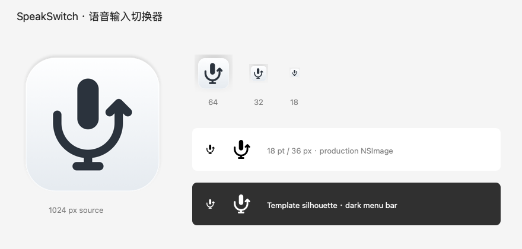

# 声选 · SpeakSwitch

**语音输入切换器。一个 Fn，自由选择你正在用的语音输入法。**

[下载 v0.1.0 · Apple Silicon](https://github.com/lizheyong/SpeakSwitch/releases/download/v0.1.0/SpeakSwitch-arm64.zip) · [版本发布](https://github.com/lizheyong/SpeakSwitch/releases) · [兼容性记录](docs/COMPATIBILITY.md) · [反馈问题](https://github.com/lizheyong/SpeakSwitch/issues)



语音输入法越来越多，体验、价格和免费额度也在变化。想换一家试试，却要重新适应快捷键，还可能遇到几个应用同时占用 Fn。

声选是原生 macOS 菜单栏应用：完成一次接入后，用同一个 **Fn** 说话，随时切换 Typeless、Chatterfly、微信输入法或其他工具。原应用继续负责识别、翻译和文字上屏，也继续使用自己的账号与额度。

## 能做什么

- **One Fn**：点按开始，再按结束。点击菜单栏切换输入法，或用 `⌃⌥⌘Space` 循环选择。快捷切换只经过正在运行且勾选「参与快捷切换」的应用，已退出的应用自动跳过。
- **共享词表**：在本机维护常用词和备注，导入、导出 TXT / CSV，并用 JSON 备份；为支持导入的应用准备词表。
- **本机统计**：按输入法查看启动次数、估算使用时长和听写／翻译分布，了解自己更常用哪一款。
- **原生 Mac 体验**：系统菜单、分栏表单、深浅色外观、真实应用图标和切换提示；支持添加自己的 `.app`。

| 按键 | 操作 |
| --- | --- |
| `Fn` | 点按开始语音输入，再按一次结束 |
| `Shift + Fn` | 触发当前应用已接入的翻译动作 |
| `Control + Option + Command + Space` | 切换到下一个已接入的应用 |

输入法列表显示「运行中 / 未启动」，每个已接入应用都有「参与快捷切换」开关。关闭该开关后，即使应用仍在运行也不会进入循环。只有主动点击「启动并使用」才会打开未启动的应用；仅关闭窗口的应用可能仍在后台运行。全部退出或全部排除时，快捷切换保持当前选择并显示提示。

切换输入法前先结束当前录音。声选转发快捷键，录音状态和上屏结果以原应用为准。翻译需要原应用提供对应功能；Typeless 用 `Shift + Fn` 开始、单独按 `Fn` 结束。

## 安装

需要 **macOS 13+**。v0.1.0 下载包面向 **Apple Silicon（arm64）**；Intel Mac 可以[从源码构建](#从源码构建)。

1. 下载 [SpeakSwitch-arm64.zip](https://github.com/lizheyong/SpeakSwitch/releases/download/v0.1.0/SpeakSwitch-arm64.zip)。
2. 解压后，将 `声选.app` 放到 `~/Applications` 或 `/Applications`，从固定位置打开。
3. 跟随接入助手完成权限和快捷键设置。

**此版本未使用 Developer ID 签名，也未经过 Apple 公证。** 只在信任源码及下载来源后运行。若 macOS 阻止打开，先尝试启动应用，再按系统提示到「系统设置 → 隐私与安全性」选择「仍要打开」；具体操作见 [Apple 官方说明](https://support.apple.com/zh-cn/102445)。也可以自行审核源码并构建。

## 五步上手

1. **选择输入法**：助手检测已安装的应用，也支持手动添加 `.app`。原应用先完成自身登录、麦克风及文字输入权限设置。
2. **允许系统权限**：给声选开启「辅助功能」和「输入监控」。部分 macOS 将辅助功能显示为「设备控制和数据访问」。返回后状态会刷新；按系统要求重开声选后，可以继续助手进度。声选不需要麦克风权限。
3. **检查 Fn 占用**：助手检查已安装的语音应用和飞书 / Lark，显示具体 Fn 绑定或待检查项。逐项释放 Fn 后继续；原应用更新后，手动确认项会重新提示检查。
4. **设置专属快捷键**：按应用内教程，把同一组组合键分别设置到原应用和声选，释放所有原生 Fn 绑定，再点击「保存并选用」。
5. **亲自试用 Fn**：在助手的练习区或常用输入框中，点按 Fn 开始、再按 Fn 结束。确认文字上屏后勾选结果并完成。

Typeless、网易叭哥说支持读取本机保存的快捷键，并在接入页点击「填入已读取的快捷键」。这是导入声选的路由设置；原应用仍含 Fn 的动作需要在原应用修改。读取失败或格式变化会显示「待检查」。飞书、其他输入法和系统键盘设置通过逐项引导确认；声选不自动批准系统权限。

主界面和菜单栏提供「Fn 冲突检查」。返回声选时和运行期间每 30 秒重新扫描；新检测到的已知应用会进入清单。手动确认按应用版本和安装位置保存，标记为「已手动确认」，不会冒充自动检测结果。清单不覆盖所有软件，已保存的配置也不能证明原应用已经生效。

可以回退或「稍后设置」，已保存的配置会保留。练习文字只在内存中临时显示，退出助手后清空。

**释放 Fn 时要检查所有常驻语音应用**，包括未加入声选的应用。系统键盘的「按下 🌐 / Fn 键时」应设为「不执行任何操作」，系统听写也改用不含 Fn 的快捷键。几个容易遗漏的设置：

| 应用 | 语音输入建议 | 还需要检查 |
| --- | --- | --- |
| Typeless | 左 Control + 左 Option + `1`（`⌃⌥1`） | 设置 → Keyboard shortcuts：翻译可用 `⌃⌘1`；随便问的 `Fn + Space` 改为 `⌥⌘1`，并清理其他 Fn 绑定。每组最多 3 个键 |
| Chatterfly | Control + Option + Shift（`⌃⌥⇧`） | 指令模式的双击 Fn 改为 `⌥⇧⌘`。快捷键使用最多 3 个修饰键；AI 指令与翻译是不同动作 |
| 飞书 / Lark（内置语音） | 例如 Control + Option + `9`（`⌃⌥9`） | 设置 → 效率 → 语音输入 → 立即设置：将长按 Fn 改为独立组合，重新打开设置确认已保存；无需把飞书加入语音输入法列表 |
| 网易叭哥说 | Control + Option + `7`（`⌃⌥7`） | 翻译可用 `⌃⌘7`；随便问的 `Fn + Space` 也需释放，例如改为 `⌥⌘7` |
| 微信输入法 | 左 Control + 左 Option + `2`（`⌃⌥2`） | 设置「启动语音输入」，释放原 `Fn + Space`；选择点按启动的功能，区别于「按住说话」 |

微信语音输入需要系统当前选中微信输入源。声选在选用微信、启用 Fn 或准备测试时会选择它；手动切到 ABC 后，请重新选用微信或点击「重新准备试用」。

设置页打开期间 Fn 接管暂停。折叠的排查工具可在 3 秒后发送原应用快捷键；若开始录音，使用原应用快捷键结束，关闭设置页后再试 Fn。

## 兼容性

| 输入法 | 已记录的语音输入实测 | 翻译 |
| --- | --- | --- |
| Typeless 2.8.2 | Fn 开始、结束、文字上屏；与 Chatterfly 切换 | 已实测 |
| Chatterfly 1.0.7.13415 | Fn 开始、结束、文字上屏；与 Typeless 切换 | 未接入 |
| 微信输入法 2.2.3 (657) | Fn 开始、持续录音、结束、文字上屏；自动选择微信输入源 | 未接入 |
| 豆包输入法 | 接入模板，尚未实测 | 待确认 |
| Spokenly | 接入模板，尚未实测 | 待确认 |
| 闪电说 | 接入模板，尚未实测 | 待确认 |

### 当前验证范围

实测覆盖记录中的应用版本与构建：Typeless 和 Chatterfly 对应功能构建 `9da51c9`，微信对应随后完成的原生界面构建。当前 Fn 冲突检查代码通过 **74/74 项测试**（21 项应用测试、53 项核心测试）。更名后的四步助手、权限状态、滚动与底栏、试用确认按钮及设置页已完成本机界面检查；原有输入法配置保留，Fn 已就绪。三款输入法的真人语音结果沿用对应功能构建的记录，尚未在更名后的发布包逐项重测。完整证据与限制见 [兼容性记录](docs/COMPATIBILITY.md)。

自定义应用需要提供可配置的全局快捷键、支持点按切换录音，并接受系统合成键盘事件。声选不会修改第三方应用的私有快捷键配置。外接键盘的 Fn 若仅在键盘固件内部工作，macOS 无法将它交给声选。

## 共享词表

在「共享词库」维护一份标准词表，支持词语、备注、搜索、编辑和文件导入导出：

| 格式 | 内容 |
| --- | --- |
| TXT | 每行一个词 |
| CSV | UTF-8、单列、无表头，每行一个词 |
| JSON | 完整备份，保留词语和备注 |

Typeless 和 Chatterfly 的「准备导入」会生成 CSV、在 Finder 中定位文件并打开原应用。随后由你在原应用词库中导入、检查预览并确认。

**这是手动词表交接，没有后台双向同步。** 修改或删除本机词条不会自动改变原应用的词库。已有词条通过文件导入或手动整理；声选不直接读取或写入第三方私有词库数据库。备注与纠错替换规则不会作为标准词发送。各家的格式与入口见 [词库兼容性](docs/COMPATIBILITY.md#共享词库兼容性)。

## 从源码构建

使用 Xcode 或 Command Line Tools。测试需要 Swift 6 和 macOS 14+；应用最低运行版本为 macOS 13。项目使用 SwiftUI、AppKit、Core Graphics，无第三方依赖。

```sh
git clone https://github.com/lizheyong/SpeakSwitch.git
cd SpeakSwitch
./scripts/test.sh
./scripts/build-app.sh --install
open "$HOME/Applications/声选.app"
```

只构建、不安装：

```sh
swift build --build-system native
./scripts/build-app.sh
```

产物为 `dist/声选.app` 和 `dist/SpeakSwitch-<架构>.zip`；`--install` 安装到 `~/Applications/声选.app`。源码支持 Apple Silicon 与 Intel 本机编译。GitHub Actions 运行测试、构建并上传 `SpeakSwitch-macOS-unsigned` 产物。

## 数据与权限

声选在本机处理快捷键，**不录音、不记录其他应用中的键入内容，不调用语音模型或网络服务**。语音应用自行处理音频、网络请求、账号和额度。点击官网链接会打开浏览器。

- **辅助功能**用于发送快捷键，**输入监控**用于接收 Fn 与组合键。
- **练习输入区**仅在内存中临时显示文字，退出助手后清空。助手只保存步骤、选择和确认状态。
- **使用统计**记录输入法、听写／翻译类型与开始／结束时间。时长由 One Fn 操作配对估算，不能证明原应用实际录音，也不包含直接在原应用中启动的使用。
- **快捷键诊断**只保存短时、带本应用标记的合成事件元数据及权限、修饰键状态，不保存键入或转写正文；每次测试覆盖上一份。

配置、词库和统计保存在 `~/Library/Application Support/Voice Switch/`；诊断日志为 `~/Library/Caches/Voice Switch/shortcut-test.log`。目录保留原名称，已有数据无需迁移。

## 参与改进

欢迎提交 [Issue](https://github.com/lizheyong/SpeakSwitch/issues) 或 Pull Request。反馈接入问题时，请附上 macOS 版本、输入法版本、快捷键设置，以及原应用快捷键和 Fn 各自的响应；无需提供音频或转写正文。

更多说明：[兼容性与排查](docs/COMPATIBILITY.md) · [界面设计](docs/DESIGN.md) · [图标来源](docs/ASSETS.md)

## English

**SpeakSwitch** is a native macOS voice input switcher. Keep **one Fn key** while switching between dictation apps as their experience, pricing, and free allowances change. Apps stay running; SpeakSwitch routes a dedicated shortcut to the selected app.

It includes a five-step setup assistant with Fn conflict preflight, a local shared vocabulary with TXT/CSV import and export, JSON backups, and local usage estimates. Dictionary handoff is manual, without background two-way synchronization. Typeless, Chatterfly, and WeType have recorded real-keyboard acceptance; only Typeless translation has been verified. Other bundled providers are untested templates. See the [compatibility record](docs/COMPATIBILITY.md) for versions and build boundaries.

[Download v0.1.0 for Apple Silicon](https://github.com/lizheyong/SpeakSwitch/releases/download/v0.1.0/SpeakSwitch-arm64.zip). Requires macOS 13+. Intel users can build from source. This release is not Developer ID signed or notarized: run it only if you trust the source and download, and follow macOS Privacy & Security prompts to open it. SpeakSwitch does not record audio or log typing in other apps; practice text is temporary in-memory content.

## License

[MIT](LICENSE) © Voice Switch contributors. Third-party icons and trademarks remain the property of their owners; see [asset attribution](docs/ASSETS.md).
